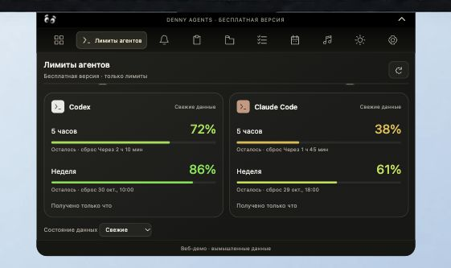
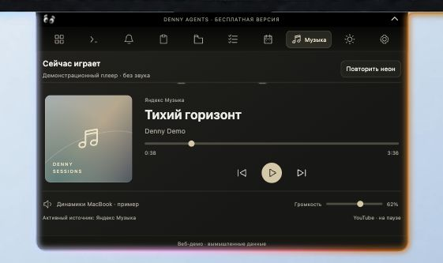
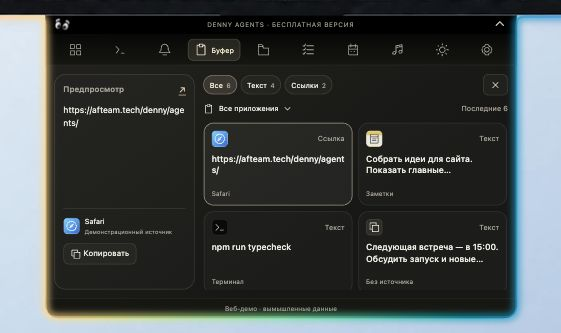
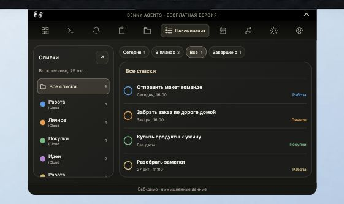

# Denny Agents

**Your agents and everyday Mac tools, right beside the camera.**

A standalone notch app with a free edition and a separately activated full edition.

[**Download 0.4.0**](https://github.com/LLC-AFTeam-Tech/denny-for-agents/releases/tag/v0.4.0) · [**Try the interactive demo**](https://afteam.tech/denny/agents/) · [**Русская версия**](README.ru.md)

## A new everyday workspace

<table>
<tr>
<td width="50%" align="center"> <strong>Music that stays close</strong> Artwork, playback controls and the active media source.</td>
<td width="50%" align="center"> <strong>Copy, keep, share</strong> Clipboard cards, a file shelf and AirDrop.</td>
</tr>
<tr>
<td align="center"> <strong>Your day at a glance</strong> Calendar, Mac Reminders and weather.</td>
<td align="center"> <strong>Keep track of your agents</strong> Claude Code and Codex limits, reset times and event notifications.</td>
</tr>
</table>

## What's new in 0.4.0

- **Nine free sections:** Overview, agent limits, Notifications, Clipboard, Files, Reminders, Calendar, Music and Weather.
- **A redesigned notch:** rounded panels, consistent perimeter lighting and a customizable overview with up to five cards.
- **Agent limits first:** remaining allowance, reset times and colors that move from red to green as available allowance increases. Chats and agent control belong to the full edition.
- **Notification cards:** app icons, filters, a summary and actions to read or hide entries in the notch feed.
- **Clipboard cards:** source-app icons when available, type/app filters and a preview of the selected item.
- **Files and AirDrop:** drag files onto the notch; filter images, documents and archives, then share through macOS.
- **Mac Reminders:** lists with their colors, due dates and completion controls. Calendar settings bring together Mac calendars, Google through the Mac Calendar account, and Yandex.
- **Music and weather in the overview:** album artwork, weather conditions and temperature. Media selection accounts for music continuing in Yandex Music while a browser video is paused.
- **License and updates inside Settings:** activate with a separate Agents key and check the dedicated Agents update channel.

### See the design

These are screenshots of our **interactive website demo with fictional data**, not recordings of a user's desktop. Illustrations above are promotional artwork. Explore the working demo on [the product page](https://afteam.tech/denny/agents/).

| Agent limits | Music |
| --- | --- |
|  |  |
| Clipboard cards | Colored reminder lists |
|  |  |

## Free and full editions

| Feature | Free | Full / Agents Paid |
| --- | :---: | :---: |
| Overview, Claude Code / Codex limits and agent event notifications | ✓ | ✓ |
| Mac notifications, clipboard, files and AirDrop | ✓ | ✓ |
| Calendar, Mac Reminders, music and weather | ✓ | ✓ |
| Agent chats and agent control | — | ✓ |
| Office on VPS, ∞ALL, automation and other advanced sections | — | ✓ |

**Denny Agents is independent of the main Denny assistant.** They have separate apps and licenses. A main Denny key does not unlock Agents Paid. Enter an **Agents key** in the notch's **Settings → License and updates**. Claude/Codex accounts, subscriptions, API usage and servers are provided separately.

## Install on Mac

1. Download **[denny-agents-0.4.0-mac-arm64.dmg](https://github.com/LLC-AFTeam-Tech/denny-for-agents/releases/download/v0.4.0/denny-agents-0.4.0-mac-arm64.dmg)**.
2. Open the DMG and drag **Denny Agents** to **Applications**.
3. Launch it and move the pointer to the top center of the screen to open the notch. Use the gear button for settings.

**Requirements:** macOS 13 or later and an Apple Silicon Mac (M1 or later). This release does not include an Intel installer. Installing Agents does not replace the main Denny AI app.

**Apple notarization:** this build is signed with Apple Development, not Developer ID, and is not notarized. macOS may block the first launch. For a download you trust, use **System Settings → Privacy & Security → Open Anyway** if macOS offers it. Do not disable macOS security globally.

### Connect the features you use

- **Calendars and reminders:** enable access in settings. To use Google Calendar, add the Google account in **macOS System Settings → Internet Accounts**, enable Calendar, then connect Mac Calendar in Agents.
- **Mac app notifications:** their history requires Full Disk Access for Agents. Agent events are a separate source. Read/hide actions only affect the notch feed, not the original apps.
- **AirDrop:** add a file to the shelf, select it and choose AirDrop; complete the transfer in the macOS sharing interface.
- **Updates:** open **Settings → License and updates**. Agents uses its own HTTPS update channel; downloaded updates are installed when you choose to install them.

For this release, use the DMG above. Older Homebrew and source-build instructions apply to the legacy 0.3.x app.

## Data and permissions

Clipboard history, calendar and reminder data are handled on the Mac. Permissions are requested for the features that need them. Online features use their corresponding services: for example, license activation, update delivery, weather and connected agent services. The website demo uses fictional data and does not read your Mac.

## Repository and licenses

The source code already present in this repository belongs to the **legacy 0.3.x app**. Its existing [MIT license](LICENSE) remains unchanged. The new 0.4.0 application source is **not published here**; the release contains one installer attachment. This README and the public presentation images describe the new release.

The Denny name, character, animations, icon and sounds retain their [asset license](LICENSE-ASSETS.md). Third-party notices are included in the app, together with a link to [corresponding library sources and build materials](https://shop.afteam.tech/agents/third-party/telegram-runtime-20261024-sources.tar.gz).

[Legacy 0.3.2 documentation](https://github.com/LLC-AFTeam-Tech/denny-for-agents/blob/v0.3.2/README.md) · [Release notes and checksum](https://github.com/LLC-AFTeam-Tech/denny-for-agents/releases/tag/v0.4.0) · [Support](https://t.me/AFTeamStore_bot)

Made by AFTEAM. Independent of Anthropic and OpenAI. Claude, Claude Code, Codex and other product names belong to their respective owners.
