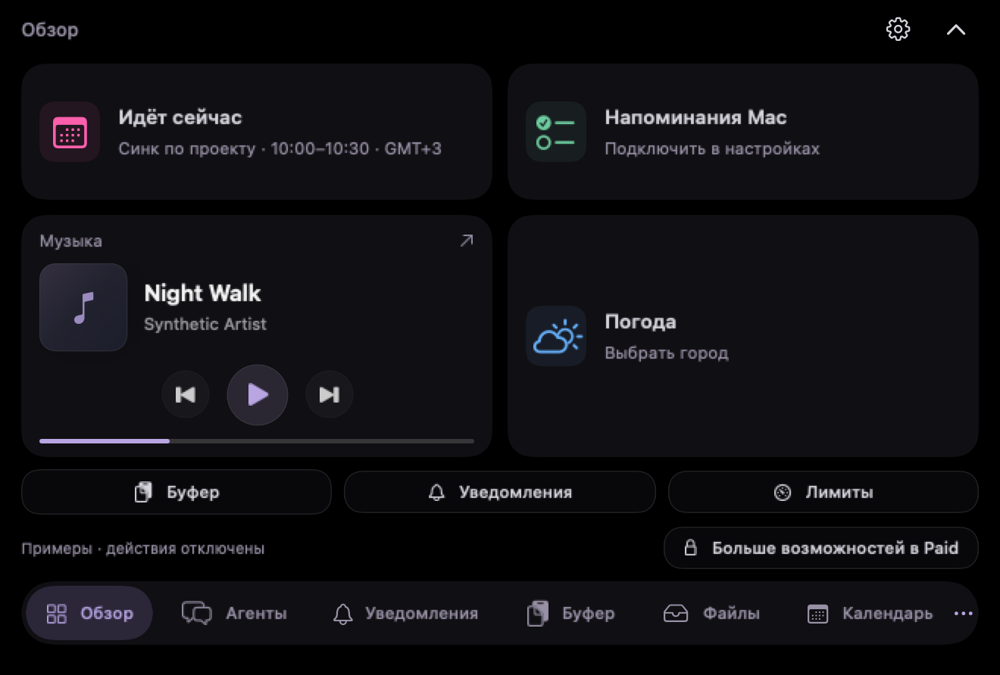
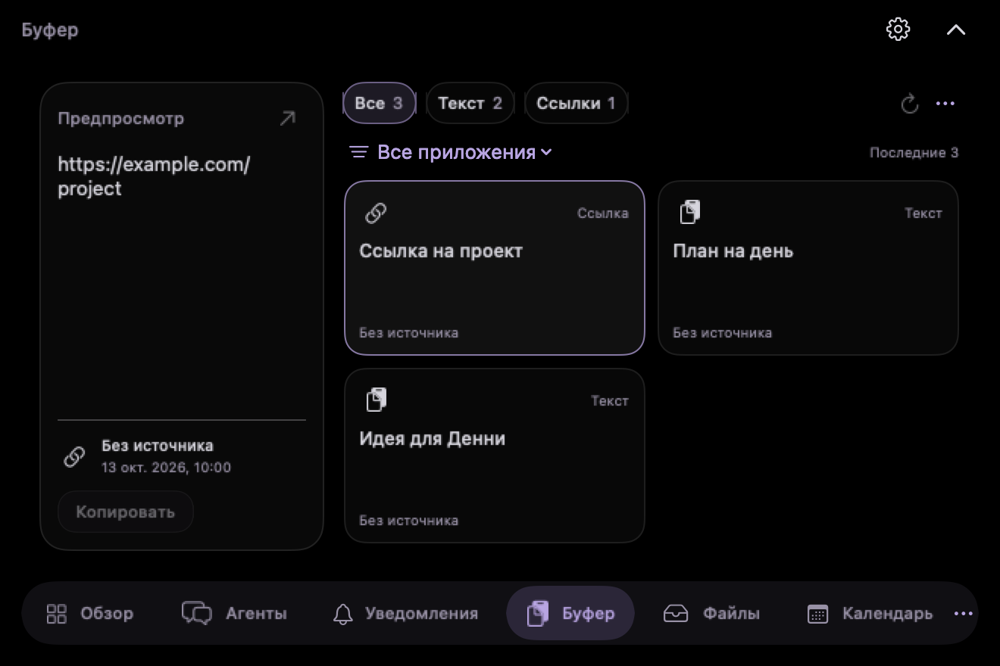

# Denny Agents

**Агенты и повседневные инструменты Mac — рядом с камерой.**

Самостоятельный нотч с бесплатной и полной версиями.

[**Скачать 0.5.0**](https://github.com/LLC-AFTeam-Tech/denny-for-agents/releases/tag/v0.5.0) · [**Попробовать в браузере**](https://afteam.tech/denny/agents/) · [**English**](README.md)

## Всё важное — в одном месте

<table>
<tr>
<td width="50%" align="center"> <strong>Музыка рядом</strong> Обложки, управление воспроизведением и активный источник звука.</td>
<td width="50%" align="center"> <strong>Скопировать, сохранить, передать</strong> Карточки буфера, полка файлов и AirDrop.</td>
</tr>
<tr>
<td align="center"> <strong>День одним взглядом</strong> Календарь, напоминания Mac и погода.</td>
<td align="center"> <strong>Агенты на виду</strong> Лимиты Claude Code и Codex, время сброса и уведомления о событиях.</td>
</tr>
</table>

## Новое в 0.5.0

- Чёрный нотч с лавандовыми акцентами, нижняя навигация с подписями и меню всех разделов.
- Обзор сохраняет выбранные карточки; добавлены настоящее управление музыкой и быстрые переходы к буферу, уведомлениям и лимитам.
- Обновлены календарь, элементы управления и оформление Claude/Codex; цвета списков напоминаний и смысловые цвета лимитов сохранены.
- Мастер подключения Android внутри настроек: Wi-Fi/VPN или свой VPS, подключение агентов и папок, QR и подтверждение телефона. Для управления нужны Agents Paid и Android-приложение; Mac должен оставаться в сети.
- Сохранены функции Free/Paid, настройки и отдельная активация Agents. Реальное обновление из отдельной официальной копии 0.4.0 до 0.5.0 проверено с сохранением профиля.

На изображениях ниже — **нативный интерфейс Mac с синтетическими тестовыми данными**, а не частные разговоры или реальная активность пользователя.

| Нативный обзор | Нативный буфер |
| --- | --- |
|  |  |

## Возможности приложения

- **Девять бесплатных разделов:** обзор, лимиты агентов, уведомления, буфер, файлы, напоминания, календарь, музыка и погода.
- **Обновлённый нотч:** скруглённые панели, единая подсветка по периметру и обзор с выбором до пяти карточек.
- **Лимиты агентов на первом месте:** остаток, время сброса и цвета от красного к зелёному по мере увеличения доступного лимита. Чаты и управление агентами относятся к полной версии.
- **Карточки уведомлений:** иконки приложений, фильтры, сводка и действия «Прочитано» / «Скрыть» внутри ленты нотча.
- **Буфер карточками:** иконка приложения-источника, когда оно определено, фильтры по типу и приложению, предпросмотр выбранной записи.
- **Файлы и AirDrop:** перетаскивание в нотч, отдельные фильтры изображений, документов и архивов, передача средствами macOS.
- **Напоминания Mac:** списки с цветами, сроки и отметка выполнения. В настройках календаря — Mac, Google через календарь Mac и Яндекс.
- **Музыка и погода в обзоре:** обложка трека, температура и погодные условия. Выбор источника учитывает музыку, которая продолжает играть в приложении Яндекс Музыки после паузы видео в браузере.
- **Лицензия и обновления в настройках:** активация отдельным ключом Agents и собственный канал обновлений приложения.

## Бесплатная и полная версии

| Возможность | Бесплатная | Полная / Agents Paid |
| --- | :---: | :---: |
| Обзор, лимиты Claude Code / Codex и уведомления о событиях агентов | ✓ | ✓ |
| Уведомления приложений Mac, буфер, файлы и AirDrop | ✓ | ✓ |
| Календарь, напоминания Mac, музыка и погода | ✓ | ✓ |
| Чаты и управление агентами | — | ✓ |
| Office на VPS, ∞ALL, автоматизация и остальные расширенные разделы | — | ✓ |

**Denny Agents и основной помощник Денни — самостоятельные продукты.** У них отдельные приложения и лицензии. Ключ основного Денни не активирует Agents Paid. Собственный **ключ Agents** вводится в **«Настройки → Лицензия и обновления»** внутри нотча. Учётные записи и подписки Claude/Codex, API и серверы обеспечиваются отдельно.

## Установка на Mac

1. Скачайте **[denny-agents-0.5.0-mac-arm64.dmg](https://github.com/LLC-AFTeam-Tech/denny-for-agents/releases/download/v0.5.0/denny-agents-0.5.0-mac-arm64.dmg)**.
2. Откройте DMG и перенесите **Denny Agents** в «Программы».
3. Запустите приложение и подведите курсор к верхнему центру экрана. Настройки открываются кнопкой с шестерёнкой в нотче.

**Требования:** macOS 13 или новее, Mac с Apple Silicon (M1 и новее). Установщика для Intel в этом выпуске нет. Установка Agents не заменяет основной Denny AI.

**Проверка Apple:** сборка подписана Apple Development, а не Developer ID, и пока не нотариализована. macOS может заблокировать первый запуск. Для доверенного скачанного приложения используйте «Системные настройки → Конфиденциальность и безопасность → Всё равно открыть», если macOS предлагает эту кнопку. Отключать защиту системы целиком не нужно.

### Подключите нужные функции

- **Календарь и напоминания:** включите доступ в настройках. Для Google добавьте учётную запись в «Системные настройки macOS → Учётные записи интернета», включите календарь и подключите календарь Mac в Agents.
- **Уведомления приложений Mac:** чтение их истории требует полного доступа к диску для Agents. События агентов — отдельный источник. «Прочитано» и «Скрыть» меняют только ленту нотча, а не исходные приложения.
- **AirDrop:** добавьте файл на полку, выберите его и нажмите AirDrop; завершите передачу в системном окне macOS.
- **Обновления:** откройте «Настройки → Лицензия и обновления». У Agents собственный HTTPS-канал; установка загруженного обновления выполняется по вашему выбору.

Для версии 0.5.0 используйте DMG выше. Старые инструкции Homebrew и сборки из исходников относятся к прежнему приложению 0.3.x.

## Данные и разрешения

История буфера, календари и напоминания обрабатываются на Mac. Доступ запрашивается для функций, которым он нужен. Сетевые возможности обращаются к соответствующим сервисам: например, активация лицензии, доставка обновлений, погода и подключённые сервисы агентов. Веб-демо использует вымышленные данные и не читает ваш Mac.

## Репозиторий и лицензии

Ранее опубликованные здесь исходники относятся к **прежнему приложению 0.3.x**; их [лицензия MIT](LICENSE) сохраняется. Исходный код нового приложения 0.5.0 **сюда не загружен**. В релизе — одно вложение с установщиком; README и публичные изображения описывают новый выпуск.

Имя, персонаж, анимации, иконка и звуки Денни сохраняют [лицензию на материалы](LICENSE-ASSETS.md). Уведомления о сторонних лицензиях включены в приложение; [соответствующие исходники библиотек и материалы сборки](https://shop.afteam.tech/agents/third-party/telegram-runtime-20261024-sources.tar.gz) доступны отдельно.

[Инструкция прежней 0.3.2](https://github.com/LLC-AFTeam-Tech/denny-for-agents/blob/v0.3.2/README.ru.md) · [Описание релиза и контрольная сумма](https://github.com/LLC-AFTeam-Tech/denny-for-agents/releases/tag/v0.5.0) · [Поддержка](https://t.me/AFTeamStore_bot)

Сделано командой AFTEAM. Независимый проект, не связанный с Anthropic или OpenAI. Названия Claude, Claude Code, Codex и других продуктов принадлежат их владельцам.
